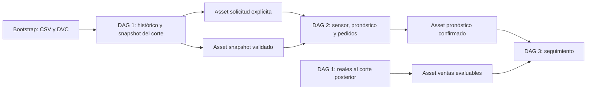

# Reconstrucción reproducible desde los originales

## Prerrequisitos

- Python 3.12 disponible como `python3.12` (o mediante `LAB1_PYTHON`).
- Docker Desktop/Engine y Compose en ejecución, con acceso a Internet si faltan imágenes.
- Los cinco CSV de Kaggle en `data/original/`: `train.csv`, `stores.csv`,
  `holidays_events.csv`, `oil.csv`, `transactions.csv`.
- Acceso de lectura al remoto DVC `google_drive`, con autenticación local ya
  configurada. No se entregan credenciales en Git. La autorización OAuth de una
  cuenta nueva es un prerrequisito externo, no se puede fabricar automáticamente.

## Un comando

Desde la raíz del repositorio:

```bash
sh scripts/bootstrap.sh --origin 2017-03-12
```

El script crea `.venv` si falta, comprueba Python 3.12, instala el lock con hashes,
instala el proyecto editable y verifica compatibilidad. Después ejecuta el
bootstrap sin preguntas ni pasos manuales de ingesta, DAGs o Registry.

Para especificar todas las fechas y el nombre de la instancia:

```bash
sh scripts/bootstrap.sh --origin 2017-03-12 \
  --issued-at 2017-03-12T12:00:00Z --evaluated-at 2017-04-09T12:00:00Z \
  --instance repro-marzo12 --airflow-port 8083 --mlflow-port 5013
```

La emisión predeterminada es 12:00 UTC del origen, equivalente a 06:00 Guatemala.
La evaluación predeterminada es 28 días después. Son cortes históricos explícitos,
no fechas calculadas a partir del reloj actual. El origen necesita 28 días previos
disponibles, siete días dentro del histórico y un Champion ya evaluado al corte
(el actual estuvo disponible desde 2017-03-03T12:00:00Z).

Si falta una entrega por retraso simulado, el proceso falla indicando las fechas;
no inventa ceros ni desplaza la emisión. También exige entregas reales para los
siete días al corte de evaluación. Las ausencias de filas siguen siendo ausencias.

## Qué prepara

1. Comprueba la presencia de los cinco archivos; ignora los CSV ajenos al laboratorio.
2. Recupera de DVC `models/current.dvc` y `models/champion_restore.dvc`.
3. Genera la simulación determinista completa desde los originales en el directorio
   propio de la instancia. Si ya existe, verifica y reutiliza esa generación.
4. Inicializa una bandeja operativa propia. El histórico se carga desde el catálogo
   maestro; la bandeja contiene el snapshot de tiendas y entregas posteriores al
   corte inicial. No vuelve a liberar todos los lotes históricos como novedades.
5. Genera secretos locales, Compose y política de replay sin un snapshot preexistente.
6. Reutiliza imágenes oficiales locales; solo descarga las que falten. Construye
   una imagen de Airflow e inferencia directamente desde la imagen oficial,
   sin depender de `lab1-airflow:3.3.2` ni de una imagen de otro proyecto.
7. Levanta PostgreSQL/MLflow propios y restaura el Champion y sus cuatro validaciones.
8. Inicializa Airflow y el catálogo vacío de seguimiento; levanta API, scheduler
   y dag-processor y habilita los tres DAGs.
9. Ejecuta el DAG 1 para la carga inicial completa al corte histórico configurado.
10. Libera entregas disponibles a la emisión y ejecuta DAG 1 para la ventana de
    28 días previos y calendario conocido del horizonte de siete días.
11. La confirmación de ese snapshot publica un Asset de solicitud explícita;
    DAG 2 genera pronósticos/pedidos y confirma su publicación completa.
12. Libera reales/correcciones disponibles a la evaluación y ejecuta DAG 1 para
    esas fechas. El Asset de ventas activa DAG 3 y se esperan métricas completas.

No se entrenan modelos ni se cambian los resultados existentes del laboratorio.
El pipeline solo lee la bandeja; las liberaciones las realiza `release.publish_next`.
Cada entrega conserva `available_at`, revisiones y checksums históricos originales.

## Encadenamiento nativo



DAG 2 usa `AssetOrTimeSchedule`: conserva su cron semanal y se activa además por
`lab1.pronostico_solicitado`. **No se suscribe a cada snapshot ni a cada sondeo**.
Una solicitud contiene origen, emisión, versión del modelo y snapshot confirmado
por el productor. El usuario nunca necesita conocer su ID. Tras confirmar la
publicación, ese snapshot descubierto queda fijado automáticamente en la política
generada para evitar ambigüedad en los siguientes replays semanales. Un fallo de ingesta
no emite la solicitud; un fallo de pedidos no emite el pronóstico confirmado.

DAG 3 conserva `pronósticos OR ventas`; una evaluación temprana puede quedar
pendiente sin registrar métricas ficticias. Las ventas posteriores producen otra
evaluación sin cambiar las predicciones originales.

El cron físico de la instancia se activa desde un timestamp persistido al crear
su entorno, para no lanzar una carga periódica atrasada durante la preparación.
Ese timestamp solo controla al scheduler; no se usa como conocimiento de datos.
La ingesta automática usa el corte de negocio explícito de la instancia, mientras
el backfill solicitado usa sus propios cortes. Se conserva la frecuencia de tres
horas y el pronóstico semanal, sin utilizar ventas de 2026.

## Persistencia e idempotencia

La instancia predeterminada `repro` usa:

- Proyecto/red/volúmenes con prefijo **`lab1-repro`**, sin recursos previos de lab1.
- Airflow en `http://localhost:8083`; MLflow en `http://localhost:5013`.
- Usuario Airflow `admin`; contraseña en `data/bootstrap/repro/.env` (permisos 0600).
- Simulación, bandeja, políticas, snapshots y resultados en `data/bootstrap/repro/`.
- Bases de PostgreSQL y MLflow, artefactos, logs y autenticación en volúmenes propios.

Todo `data/bootstrap/` permanece ignorado por Git, incluidos secretos y datos.
Un lock local serializa dos invocaciones de la misma instancia. Los DAG Runs
manuales tienen IDs deterministas; se reutilizan si su configuración coincide.
El manifiesto de generación, los publicadores y la restauración del modelo
conservan sus verificaciones e identidades. El resultado queda en `result.json`
y en un informe identificado por escenario/código.

Repetir **el mismo comando** reutiliza la generación, servicios, runs, modelo y
publicaciones. Cada instancia queda fijada a su escenario. Para otro corte o una
reproducción desde volúmenes vacíos, elegir otro `--instance` y puertos disponibles.
No borrar volúmenes ni cambiar silenciosamente un escenario ya inicializado.
Si un DAG falla, el bootstrap informa su nombre/ID y no declara éxito; se conserva
la evidencia. Un problema externo transitorio puede resolverse y reintentarse;
un DAG Run marcado fallido requiere revisar y limpiar sus tareas en Airflow.

Los logs de comandos están en `data/bootstrap/<instancia>/logs/commands.log`.
La espera por fase tiene un límite de 1.800 segundos, configurable con `--timeout`.

Para detener la instancia predeterminada conservando todos los datos:

```bash
docker compose --env-file data/bootstrap/repro/.env \
  -f data/bootstrap/repro/compose.yaml stop
```

No usar los comandos `make infra-*` anteriores para administrar esta instancia:
utilizan el Compose original. La configuración generada es la referencia de sus
propios servicios. Cambiar `repro` por el nombre usado en `--instance`.


## Evidencia de reconstrucción limpia (2026-11-01)

Se ejecutó el código final sobre una instancia nueva, sin simulación, snapshots,
bases ni volúmenes anteriores del laboratorio:

```bash
sh scripts/bootstrap.sh --origin 2017-03-19 --instance repro-limpio
```

| Verificación | Resultado |
|---|---|
| Carga inicial al 2017-01-01T05:00:00Z | 2.594.592 filas históricas de ventas, validadas |
| Corte de emisión | 2017-03-19T12:00:00Z |
| Horizonte | 19–25 marzo 2017 |
| Evaluación | 2017-04-16T12:00:00Z |
| Pronósticos | 12.474 filas |
| Pedidos | 1.782 tiendas/familias |
| Seguimiento | 12.474 pares evaluados, cero pendientes |
| MAE / WAPE | 61.402097134127 / 0.127762008918 |
| Cobertura P10–P90 | 0.820266153599 |

DAG Runs reales de esa reconstrucción, todos success:

- DAG 1: bootstrap-historico-4c6e36b911783a5f500c279c.
- DAG 1: bootstrap-corte-cdc1f3418fcc634235b2933a.
- DAG 1: bootstrap-reales-cdc1f3418fcc634235b2933a.
- DAG 2: asset_triggered__2026-11-01T23:23:27.648839+00:00_um5dMBsj.
- DAG 3: asset_triggered__2026-11-01T23:23:38.946892+00:00_ReSsVAXC.
- DAG 3: asset_triggered__2026-11-01T23:23:46.824013+00:00_hVk0kwWj.

Publicación de pronósticos:
97db0822ef96ef36af59071811d8d96341886c6cfbd120c5202d99f32d2afdc1.
Publicación completa:
a9b399e3e7baa4d285b48d54e68e93e96e39c222b1d3a1aadde9da1b5b8c18f2.
Seguimiento:
351230006eed62e39c246750a595b5602605d1078d80ecfd8e59d90fcd254cb3.

El informe está en data/bootstrap/repro-limpio/result.json. Se comprobó también
2017-03-12 y la repetición exacta del comando final, sin añadir DAG Runs,
versiones de modelo, runs de MLflow ni modificar los archivos publicados.
La prueba del 12 de marzo conserva su verificación en
data/bootstrap/repro-final/verification.json. Los IDs de Registry y runs son
propios de cada servidor vacío; no se exige igualar IDs entre máquinas.

Pruebas enfocadas sin fit (183 aprobadas):

```bash
.venv/bin/python -m pytest -q tests/test_bootstrap.py tests/test_forecast_clock.py \
  tests/test_orchestration.py tests/test_champion_restore.py tests/test_ingestion.py \
  tests/test_automatic.py tests/test_source_simulator.py tests/test_monitoring.py \
  tests/test_forecast_publication.py tests/test_orders.py \
  tests/test_replenishment_publication.py tests/test_publication_audit.py \
  tests/test_uncertainty.py
.venv/bin/ruff check src tests scripts dags docker/init_airflow.py
.venv/bin/ruff format --check src tests scripts dags docker/init_airflow.py
.venv/bin/python scripts/auditar_publicacion.py --working-tree
```

Ruff, formato, pip check, auditoría y sintaxis del wrapper aprobados. Los CSV,
pesos originales y entrega DVC archivada conservan sus hashes; el MLflow original
conserva su Champion v4 y 51 runs. No se entrena ningún modelo.

La repetición del escenario limpio del 19 de marzo también pasó: se conservaron
3/1/2 DAG Runs por ingesta/pronóstico/seguimiento, cinco runs de MLflow (cuatro
de restauración y uno de evaluación real), una versión del modelo y los hashes
de los 25 archivos de salida. Recibos y residuos estaban disponibles al corte.
Verificación: data/bootstrap/repro-limpio/verification.json. Los servicios de esta
instancia quedaron saludables en 8083/5013; los originales continúan en 8082/5011.
