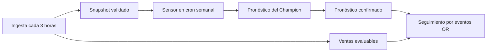

# Dependencias explícitas entre los tres DAGs

Se utiliza la API nativa de Assets de Airflow 3.3.2, sin cambiar los módulos de
negocio, modelos, contratos ni métricas. Los eventos se publican al completar una
tarea con éxito; una tarea fallida/skipped no actualiza el Asset. Los aliases
permiten emitir condicionalmente, sin eventos de sondeo vacío.
[Referencia oficial](https://airflow.apache.org/docs/apache-airflow/3.3.2/authoring-and-scheduling/asset-scheduling.html).



## Publicaciones nativas

- `lab1://ingesta/snapshots_validados`: snapshot/publicación incremental validada,
  con snapshot_id, as_of y SHA-256 de manifiesto.
- `lab1://ingesta/ventas_evaluables`: cambios de ventas con fechas cerradas que
  pueden evaluar un pronóstico existente, incluyendo revisiones históricas.
- `lab1://pronostico/publicaciones`: publicación completa confirmada por la última
  tarea del DAG 2, con publication_id, snapshot, corte, modelo/run y hash.

DAG 1 conserva `0 */3 * * *`, Guatemala y catchup=False. Los aliases de salida
se asocian al Asset concreto solo cuando existe publicación verificada. Si el
sondeo devuelve publication_id=None, no se agrega ningún evento. Cambios de oil,
feriados u otras fuentes pueden publicar snapshot, pero no disparan seguimiento
como ventas nuevas. En backfill manual se puede volver a notificar un snapshot
válido: eventos al menos una vez, consumidores idempotentes.

## Pronóstico exclusivamente semanal

DAG 2 conserva cron `0 6 * * 0`, America/Guatemala, configurable y catchup=False.
**No usa AssetOrTimeSchedule ni se suscribe a cambios de snapshot para ejecutarse**.
Al llegar su fecha semanal, `esperar_snapshot` declara el inlet y verifica que:

1. El snapshot es válido para el corte mediante los controles existentes:
   as_of <= issued_at, historia suficiente y contratos/checksums correctos.
2. Existe un evento exitoso de ingesta para ese snapshot y ese hash exacto.

El sensor usa `mode=reschedule`, con timeout configurable
`snapshot_wait_seconds` (900 por defecto), sin ocupar un worker durante la espera.
No mueve el corte para aprovechar datos futuros. Fija snapshot/origen/emisión en
XCom antes de inferir. `generar_publicacion` reutiliza el módulo existente;
`confirmar_publicacion` verifica el bundle y es el único emisor del Asset de
pronósticos. Cualquier fallo anterior impide ese evento. No se reentrena.

Para replay histórico primero ejecutar ingesta con su as_of y referencias; así
se confirma el Asset de un snapshot anterior. Después se puede lanzar DAG 2 con
origin/issued_at/snapshot_id/model_version existentes, como antes.

## Seguimiento independiente de la salud del pronóstico actual

El schedule principal de DAG 3 es **FORECASTS | SALES**, no AND. Una venta tardía
puede activar seguimiento de pronósticos históricos aunque el DAG 2 actual falle.
No depende de que los dos productores cambien simultáneamente.

Los eventos contienen **cortes de negocio**, no se utiliza su timestamp físico de
2026 como una fecha histórica. En una activación por Assets, el corte es el máximo
entre los eventos disparadores y los eventos de ventas ya conocidos. Esto permite
evaluar un pronóstico histórico recién confirmado si sus ventas ya habían sido
notificadas, sin modificar su corte de generación. El corte explícito `as_of` de
un backfill tiene prioridad y nunca incorpora el watermark de eventos futuros.

`daily_reconciliation: false` en seguimiento.yaml desactiva la ejecución diaria
incondicional. Si se habilita, AssetOrTimeSchedule agrega el cron diario configurado
como reconciliación; los eventos continúan disparando inmediatamente. No cambia
la programación semanal del DAG 2.

## Publicaciones anteriores y fallos después de escribir archivos

`orchestration bootstrap` registra una sola vez los manifiestos válidos anteriores
al despliegue de Assets en `operational/orchestration/legacy_forecasts.json`.
Los tres pronósticos históricos existentes quedaron conservados y autorizados.
El archivo no se amplía automáticamente después: un archivo nuevo necesita un
Asset exitoso de confirmación para que seguimiento lo consuma. Así, incluso si
un proceso escribe un bundle y falla antes de confirmar, no se evalúa ese bundle
por el mero hecho de aparecer en el directorio. No se elimina ni cambia ningún
pronóstico anterior.

DAG 3 combina el catálogo histórico con los eventos de pronósticos exitosos y
comprueba sus hashes. Llama al módulo de seguimiento existente solo para IDs
confirmados. Sus identidades, versiones por revisiones y runs MLflow permanecen
iguales: repetir un evento no duplica métricas ni publicaciones.

## Despliegue y migración inicial

```bash
docker build --pull=false -f docker/Dockerfile.forecast -t lab1-airflow-pronostico:3.3.2 .
docker compose --env-file .env -f docker/compose.yaml -f docker/compose.forecast.yaml \
  up -d --no-build --pull never --no-deps airflow-api airflow-scheduler airflow-dag-processor
docker exec -e PYTHONPATH=/opt/lab1/forecast_project/src lab1-airflow-scheduler-1 \
  /opt/lab1/inference/bin/python -m reposicion.orchestration bootstrap \
  --work-root /opt/lab1/operational
```

El bootstrap debe ejecutarse una única vez sobre las publicaciones preexistentes,
antes de empezar a producir nuevas publicaciones con los DAGs actualizados.
Repetirlo conserva el catálogo original. En una instalación nueva se inicializa
vacío antes de la primera publicación. No se agregan dependencias Python ni se
cambian PostgreSQL, MLflow o volúmenes. Se recrean solo procesos Airflow.

Los dos helpers nuevos se copian tanto al Python de Airflow (metadatos/SDK) como
al proyecto de inferencia (preflight sin modelo). Los módulos de negocio existentes
no se reemplazan en el entorno de Airflow ni se editan en el repositorio.


## Verificaciones reales

| Prueba | Resultado |
|---|---|
| assets_snapshot_20170305 | success; Asset snapshot (evento 1), sin seguimiento ni pronóstico automático |
| assets_ventas_20170402 | success; snapshot/ventas (2/3); seguimiento automático success |
| assets_pronostico_20170305 | success; sensor confirmado, inferencia existente y Asset pronóstico (4) |
| assets_pronostico_fallo_controlado | failed esperado por versión inexistente 999999; cero Assets y cero activaciones nuevas |
| assets_ventas_despues_fallo | success; snapshot/ventas (5/6); seguimiento histórico automático success |
| assets_sondeo_sin_novedades | success; cero entregas, sin publicación ni Assets |

Los tres DAG Runs de seguimiento, todos success y creados por Airflow:

- asset_triggered__2026-11-01T01:08:41.745082+00:00_q2Rm7o1R (consume evento 3).
- asset_triggered__2026-11-01T01:08:59.567395+00:00_RUYhj3gJ (consume evento 4).
- asset_triggered__2026-11-01T01:11:23.163485+00:00_ISVq8Ybs (consume evento 6).

El último reutilizó las cuatro evaluaciones autorizadas, sin duplicar runs ni
métricas, incluso después del fallo del DAG 2. El pronóstico nuevo válido quedó
en c677c4335f149a7b2b95c3687d9c7ae5e498ae226f4dd81049f980a1d6f42958,
12.474 filas para 5–11 marzo, mismo modelo Champion v4 y snapshot histórico.
Su seguimiento utiliza el corte conocido 2017-04-02, no la fecha física del evento.
[Run MLflow de esa evaluación](http://localhost:5011/#/experiments/8/runs/52ecf01dc1b3461d9de95390365046d0).

Se comprobó que DAG 2 tiene cron puro semanal y **cero** runs asset_triggered.
Los módulos de negocio conservan los hashes de la publicación previa; las tres
publicaciones históricas conservan exactamente sus manifiestos y archivos.
La nueva inferencia presenta diferencias flotantes máximas de 3.64e-12 frente a
la anterior, dentro de la tolerancia numérica verificada, sin cambiar código ni
pesos. La idempotencia reutiliza el archivo ya publicado sin recalcularlo.

Doce pruebas específicas sin entrenamiento aprobaron: autorizaciones históricas,
exclusión de archivos sin confirmación, integridad, cortes de eventos, ventas
relevantes, publicación recuperable, correcciones y métricas. La importación real
de los DAGs no presenta errores. El informe detallado permanece ignorado por Git
en reports/assets/verificacion.json. El fallo controlado se conserva como evidencia.
