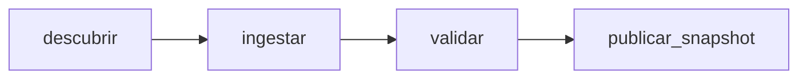

# Etapa 3: ingesta temporal, Airflow y MLflow

Esta guía conserva la implementación inicial por corte. La configuración vigente
añade sondeo cada cinco minutos y una bandeja operativa: ver
[ingesta_automatica.md](ingesta_automatica.md). Los ejemplos manuales de backfill
siguen siendo válidos.

## Infraestructura exclusiva de lab1

Se reutilizan localmente `apache/airflow:3.3.2-python3.12`, `postgres:16` y
`ghcr.io/mlflow/mlflow:v3.17.2`. La imagen `lab1-airflow:3.3.2` copia código,
configuración y DAGs sobre la base oficial, sin instalar dependencias ni descargar
la base nuevamente. PyYAML 6.0.3 ya está en la imagen de Airflow y coincide con el lock.
Airflow/MLflow no se instalan en el entorno `.venv` de desarrollo.

| Servicio Compose | Función | Acceso |
|---|---|---|
| `postgres` | PostgreSQL 16, metadatos de Airflow | `postgres:5432`, sin puerto publicado |
| `mlflow` | MLflow 3.17.2, SQLite y artefactos | http://localhost:5011; interno `http://mlflow:5000` |
| `airflow-api` | API y UI Airflow 3.3.2 | http://localhost:8082 |
| `airflow-scheduler` | Scheduler y LocalExecutor | red interna de lab1 |
| `airflow-dag-processor` | Importación y serialización de DAGs | red interna de lab1 |
| `airflow-init` | Inicialización de credenciales y migración | termina con código 0 |

El proyecto Compose se llama `lab1`; la red es `lab1_internal`. Los volúmenes son
`lab1_postgres_data`, `lab1_mlflow_db`, `lab1_mlflow_artifacts`, `lab1_operational`,
`lab1_airflow_logs` y `lab1_airflow_auth`. No se reutilizan recursos de otros proyectos.
Los puertos se comprobaron con el listado de listeners y un bind de prueba antes
de iniciar servicios. Se publican exclusivamente en `127.0.0.1`.

La base SQLite de MLflow es `/mlflow/mlflow.db`; sus artefactos se sirven desde
`/artifacts`, en otro volumen. No se comparten con PostgreSQL ni con los snapshots.
Se comprobó `/health` desde Airflow con `MLFLOW_TRACKING_URI=http://mlflow:5000`.
No se crean runs ni experimentos de prueba. El experimento `Default` lo crea MLflow
al inicializar su almacenamiento y no contiene ejecuciones.

## Preparación, inicio y parada

Desde `lab1`:

```sh
make infra-prepare
make inbox-init
make infra-build
make infra-up
make infra-status
```

Equivalentes completos:

```sh
.venv/bin/python scripts/preparar_infra.py
.venv/bin/python -m reposicion.cli initialize-inbox
docker compose --env-file .env -f docker/compose.yaml config --quiet
docker compose --env-file .env -f docker/compose.yaml build --pull=false airflow-init
docker compose --env-file .env -f docker/compose.yaml up -d --no-build --pull never
docker compose --env-file .env -f docker/compose.yaml ps
```

El preparador verifica imágenes locales y la existencia del manifiesto, prueba los
puertos y genera `.env` con permisos 600. Nunca muestra secretos ni regenera datos.
Si ya existe `.env`, lo conserva. Las variables están documentadas en `.env.example`;
no se debe reemplazar el archivo generado por la plantilla con claves vacías.

Airflow usa SimpleAuthManager, adecuado para este laboratorio local. Usuario `admin`;
la contraseña está en `LAB1_AIRFLOW_ADMIN_PASSWORD` de `.env`. No se imprime en los
informes. Los secretos Fernet, API y JWT son independientes y exclusivos de lab1.

```sh
make infra-stop
make infra-up
make infra-down
```

`stop` detiene contenedores; `up` vuelve a iniciarlos. `down` retira contenedores y
red de lab1 conservando volúmenes. **No usar `down -v` para una parada normal**:
eliminaría metadatos, snapshots, credenciales y datos de MLflow del laboratorio.
Estas órdenes no operan sobre servicios de otros proyectos.

Después de modificar Python, configuración o DAGs, ejecutar `make infra-build` y
`make infra-up`: el código está dentro de la imagen y no se monta desde el host.

## Montajes y protección del origen

La simulación completa existente se monta en `/opt/lab1/source` mediante bind `:ro`
con `create_host_path: false`. No se montan los CSV originales. No se monta el socket
Docker en Airflow. El pipeline operativo no llama al generador de entregas.

El volumen `lab1_operational` se monta en `/opt/lab1/operational`. Se separan:

```text
operational/
├── contracts/      # copia exacta de cada contrato utilizado, por SHA-256
├── plans/          # selección inmutable de entregas y corte
├── landing/        # copias de CSV y recibos verificados
├── batches/        # confirmación de ingesta completa por plan
├── quarantine/    # errores y recibos; el payload ya copiado se conserva en landing
├── validated/     # SQLite intermedio y manifiesto, por plan
└── snapshots/     # cinco CSV y manifiesto de linaje por snapshot
```

Ante un checksum inválido en el origen no se acepta el payload ni se lo repara.
La cuarentena registra recibo, fase y error. Ante un error de contrato, conserva
además el payload en landing. No se publica un snapshot parcial. Una reejecución
del mismo fallo no duplica la evidencia de cuarentena.

## DAG y módulos independientes

`lab1_ingesta_temporal` tiene cuatro tareas:



Toda la lógica está en `src/reposicion/ingestion.py`, sin importar Airflow ni MLflow.
El DAG usa TaskFlow SDK de Airflow 3 y transporta solo el ID del plan entre tareas.
Se limita a una ejecución activa; cada tarea tiene un reintento idempotente.

La ruta de backfill exige `as_of` con zona horaria. La configuración vigente del DAG
usa `*/5 * * * *` para el sondeo incremental de otra bandeja; un ciclo programado no
dispara todo el catálogo maestro. `as_of` manual selecciona la ruta histórica aquí
documentada. No se utiliza el intervalo de un trigger manual como corte del backfill.

### Ejecución pequeña y corrección histórica

La simulación existente contiene la corrección de ventas del 18 de enero de 2017,
publicada el 26 de enero a las 11:00 UTC. Se prueban dos cortes y una repetición:

```sh
docker compose --env-file .env -f docker/compose.yaml exec -T airflow-scheduler airflow dags unpause lab1_ingesta_temporal
docker compose --env-file .env -f docker/compose.yaml exec -T airflow-scheduler airflow dags trigger lab1_ingesta_temporal --run-id lab1_etapa3_inicial --logical-date 2017-01-20T12:00:00Z --conf '{"as_of":"2017-01-20T12:00:00Z","reference_start":"2017-01-18","reference_end":"2017-01-18"}'
docker compose --env-file .env -f docker/compose.yaml exec -T airflow-scheduler airflow dags trigger lab1_ingesta_temporal --run-id lab1_etapa3_corregido --logical-date 2017-01-27T12:00:00Z --conf '{"as_of":"2017-01-27T12:00:00Z","reference_start":"2017-01-18","reference_end":"2017-01-18"}'
docker compose --env-file .env -f docker/compose.yaml exec -T airflow-scheduler airflow dags trigger lab1_ingesta_temporal --run-id lab1_etapa3_repetido --logical-date 2017-01-20T12:00:01Z --conf '{"as_of":"2017-01-20T12:00:00Z","reference_start":"2017-01-18","reference_end":"2017-01-18"}'
```

Los IDs anteriores identifican las pruebas ya realizadas; para otra ejecución usar
otro `--run-id` y otra fecha lógica, conservando el mismo `as_of` si se quiere probar
idempotencia. La identidad de datos no depende del run ID ni de la fecha lógica.

`reference_start` y `reference_end` son filtros de diagnóstico opcionales e inclusivos,
aplicados a hechos y eventos; la dimensión de tiendas sigue disponible. El manifiesto
marca esta ventana: un snapshot acotado **no representa todo el histórico**. Sin la
ventana se procesa todo lo conocido al corte, incluida la carga histórica inicial.

Para inspeccionar resultados:

```sh
docker compose --env-file .env -f docker/compose.yaml exec -T airflow-scheduler airflow dags list-runs lab1_ingesta_temporal --output json
docker compose --env-file .env -f docker/compose.yaml exec -T airflow-scheduler airflow tasks states-for-dag-run lab1_ingesta_temporal lab1_etapa3_inicial --output json
docker compose --env-file .env -f docker/compose.yaml exec -T airflow-dag-processor airflow dags list-import-errors --output json
docker compose --env-file .env -f docker/compose.yaml exec -T airflow-scheduler python -c 'from pathlib import Path; print("\n".join(str(p) for p in Path("/opt/lab1/operational/snapshots").glob("*/manifest.json")))'
```

Para copiar un snapshot al host, usar `docker compose ... cp` con su ID concreto y
un destino dentro de `data/operational/`, que está excluido de Git. La API y los
logs de Airflow muestran los IDs publicados; los CSV permanecen en el volumen.

### Ejecución sin Airflow

```sh
.venv/bin/python -m reposicion.cli ingest-snapshot --as-of '2017-01-20T12:00:00Z' --reference-start 2017-01-18 --reference-end 2017-01-18
```

Usa `configs/pipeline.yaml` y por defecto escribe en `data/operational`. En Docker
las variables `LAB1_SOURCE_ROOT`, `LAB1_WORK_ROOT` y `LAB1_CONTRACTS` fijan las rutas
de los montajes y de la imagen. El CLI acepta `--pipeline-config` para otra configuración.

## Reglas temporales y de validación

- Descubrir selecciona únicamente recibos disponibles al corte y la última revisión
  conocida de cada partición. Tiendas usa el último snapshot de dimensión conocido.
- Una revisión inválida no hace retroceder silenciosamente al dato anterior: se
  bloquea el nuevo snapshot. Los snapshots publicados anteriormente se conservan.
- Ingestar copia y verifica los recibos seleccionados, sin leer payloads futuros.
- Validar comprueba cabeceras, tipos, nulos, fechas contra recibos, geografía, tiendas
  y claves globales. Un ID de ventas repetido en dos fechas también se rechaza.
- No se expanden transacciones por familia ni se unen directamente feriados a ventas.
  Se mantienen cinco tablas con sus granularidades originales.
- Ceros, ventas fraccionarias y petróleo nulo se conservan. Las fuentes o filas
  aún no disponibles no se rellenan con ceros. Las fuentes vacías se informan y
  producen CSV con cabecera; no son un error de negocio por sí solas.
- Una referencia futura de feriado puede estar permitida si ya se conocía al corte.
  Se conserva la política temporal de la etapa 2, sin inventar nuevas disponibilidades.

## Trazabilidad e idempotencia

El ID del plan/snapshot incluye corte UTC, ventana, recibos seleccionados, hash del
manifiesto de origen, generación, contrato, versión de pipeline y hash de los módulos
de procesamiento. No depende de rutas absolutas, reloj de ejecución ni run ID.
Se archiva el contrato exacto para permitir reconstrucción con esa definición.

Landing es compartido por contenido; validación y snapshots se publican en directorios
por ID. Primero se escribe en temporales y solo se publica el conjunto completo al
terminar. Reejecutar el mismo corte verifica y reutiliza los archivos, sin reescribirlos.
Si un artefacto está corrupto se falla; no se lo repara silenciosamente.

Cada snapshot contiene checksums de sus CSV, perfiles de filas/nulos/ceros, fuentes
sin filas, contrato, versión de código y todos los recibos con revisión y disponibilidad.
Al llegar una corrección, un corte posterior reemplaza la partición completa y crea
otro snapshot. Un backfill del corte anterior sigue seleccionando la versión antigua.
Cambiar código o contrato requiere descubrir otro plan; para reproducir una versión
de código antigua se necesita esa versión del repositorio. DVC sigue pendiente para
el versionado externo de los datos y modelos en su etapa correspondiente.

## Pruebas y referencias

```sh
make test
make lint
```

Las pruebas sintéticas cubren los contratos y el pipeline sin Docker. La integración
real se verificó mediante el scheduler, la API de ejecución de Airflow y PostgreSQL,
no únicamente con `dag.test()` ni mocks. Evidencia: `etapa3_resultados.md`.

Referencias oficiales consultadas:

- [Airflow 3.3.2 en Docker](https://airflow.apache.org/docs/apache-airflow/3.3.2/howto/docker-compose/index.html).
- [SimpleAuthManager](https://airflow.apache.org/docs/apache-airflow/3.3.2/core-concepts/auth-manager/simple/index.html).
- [Backend SQLite de MLflow](https://mlflow.org/docs/latest/self-hosting/architecture/backend-store/).
- [Servidor y artefactos de MLflow](https://www.mlflow.org/docs/latest/self-hosting/architecture/tracking-server/).
