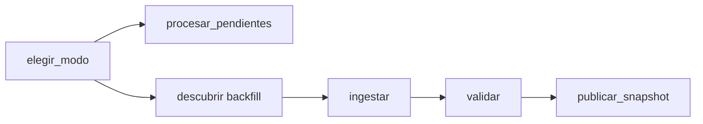

# Ingesta automática y liberación progresiva

## Operación normal

`lab1_ingesta_temporal` usa `schedule="*/5 * * * *"`, `catchup=False` y
`max_active_runs=1`. Está habilitado. El scheduler crea los runs; no se necesita
un proceso externo que llame a `airflow dags trigger` cada cinco minutos.

El DAG tiene dos rutas:



Sin `as_of` manual se usa el modo automático, con el fin del intervalo de Airflow
como corte estable. Con `as_of` explícito se conserva el backfill de la etapa 3.
Las tareas de la ruta no elegida aparecen `skipped`; es normal y el run termina
`success` si la ruta elegida finaliza correctamente.

## Tres espacios independientes

| Ubicación | Papel | Quién escribe |
|---|---|---|
| `data/simulation/` | simulación maestra ya generada | nadie durante esta mejora |
| `data/operational_inbox/` | entregas liberadas progresivamente | solo `release.py`, mediante la CLI del simulador |
| volumen `lab1_operational` | ledger, landing y publicaciones | pipeline operativo |

La bandeja operativa es nueva: se inicializó con cero entregas y no se eliminaron
archivos previos. Airflow la ve en `/opt/lab1/inbox` como bind de solo lectura.
La simulación maestra sigue montada aparte, también de solo lectura, para backfill.
Los CSV originales no se montan en los contenedores de Airflow.

## Publicación manual de entregas

Desde la raíz, sin recrear datos ni iniciar un DAG:

```sh
.venv/bin/python -m reposicion.cli initialize-inbox
.venv/bin/python -m reposicion.cli publish-next --count 1
.venv/bin/python -m reposicion.cli publish-next --count 3
```

Equivalentes: `make inbox-init`, `make publish-next` y `make publish-next COUNT=3`.
Inicializar de nuevo conserva la bandeja y devuelve su conteo actual: no la vacía.
La primera entrega predeterminada es el snapshot de tiendas para satisfacer las
referencias de las demás fuentes. Luego se usa el orden estable de disponibilidad.

También se puede elegir una entrega existente o una corrección:

```sh
.venv/bin/python -m reposicion.cli publish-next --delivery-id train/2017-01-18/r0001
.venv/bin/python -m reposicion.cli publish-next --delivery-id train/2017-01-18/r0002
```

Publicar un ID ya liberado no hace nada. Una corrección exige que su revisión
anterior esté liberada o venga en el mismo lote. No se publica una fuente que
requiere dimensión antes del snapshot de tiendas.

El productor copia CSV y sobre JSON **byte por byte** desde la simulación maestra;
no llama a `simulate` ni cambia `available_at`, referencia, revisión o checksum.
Un `released_at` separado registra cuándo se liberó físicamente la copia. La fecha
histórica y el reloj de esta demostración acelerada son dimensiones diferentes:
el corte filtra disponibilidad histórica, y el catálogo observado fija qué entregas
se habían liberado para ese ciclo. Los backfills sobre el maestro reconstruyen el
escenario histórico completo independientemente del orden físico de la demostración.

Un lock exclusivo serializa productores. Los archivos se copian antes de actualizar
atómicamente `manifest.json`; así el consumidor no ve una entrega incompleta.
Cada versión exacta del catálogo se conserva en `catalogs/<sha256>.json`, incluida
la versión inicial vacía. El publicador solo agrega entregas y versiones; no elimina
ni reescribe payloads ya publicados.

## Control persistente e incremental

La lógica está en `src/reposicion/automatic.py`, sin dependencias de Airflow.
El ledger está en:

```text
/opt/lab1/operational/automatic/<stream_id>/
├── control.sqlite
├── contracts.yaml
├── landing/
├── quarantine/
├── prepared/
└── publications/<publication_id>/
    ├── train.csv
    ├── stores.csv
    ├── transactions.csv
    ├── oil.csv
    ├── holidays_events.csv
    └── manifest.json
```

`control.sqlite` registra:

- `cycles`: run ID, corte, catálogo exacto observado, código y resultado del ciclo.
- `processed`: ID, fuente, referencia, revisión, checksum de payload y metadatos,
  recibo completo y momento de procesamiento. ID y fuente–referencia–revisión son únicos.
- `active`: revisión vigente de cada partición.
- `rows_*`: estado validado por fuente con restricciones de unicidad global.
- `publications`: publicación preparada o confirmada, con checksum de manifiesto.

Cada ciclo compara los recibos disponibles contra `processed`. **Solo abre, copia
y valida los CSV pendientes**. Los ya procesados se comparan por sus identificadores
y metadatos/checksums registrados, sin volver a abrir sus payloads. Un ID previamente
procesado que cambia de checksum se rechaza; no se acepta como una corrección silenciosa.

Si no hay novedades, se registra un resultado `no_new_deliveries`, se termina con
éxito y no se crea una publicación. Registrar el run en el ledger es evidencia de
operación, no una publicación de datos. Si falta la dimensión de tiendas se informa
`waiting_for_stores` y se dejan los recibos pendientes para otro ciclo.

Al haber novedades se valida granularidad, tipos, claves y relaciones únicamente
para esas entregas. Los snapshots nuevos leen el estado acumulado ya validado de
SQLite para materializar una vista completa; esto no es una nueva ingesta de los
archivos anteriores. Ventas fraccionarias, ceros, nulos permitidos y ausencias
conservan las políticas de los contratos de la etapa 2.

## Correcciones y recuperación

Una revisión nueva reemplaza su partición diaria dentro de una transacción. No se
suman versiones. El snapshot anterior permanece intacto; el manifiesto nuevo enlaza
su `predecessor`, recibos activos y archivos efectivamente procesados en ese ciclo.

Un error de datos revierte el lote, conserva evidencia en cuarentena y no confirma
sus entregas como procesadas. Una repetición del mismo run reutiliza el catálogo y
corte congelados, aunque el productor haya liberado otros archivos después del fallo.

Para evitar duplicados ante interrupciones, se usa publicación recuperable:

1. Se escribe un bundle completo en `prepared/`, todavía no anunciado.
2. Se confirma en una única transacción el estado, recibos, resultado del ciclo y
   referencia a la publicación preparada.
3. Se mueve el bundle a `publications/` y se confirma su estado `published`.

Si hay una interrupción entre pasos, el siguiente intento completa la publicación
sin volver a procesar los CSV confirmados. `BEGIN IMMEDIATE`, claves únicas y el
ledger serializan consumidores concurrentes. Un artefacto corrupto se rechaza,
sin reparación ni sobrescritura silenciosa.

El estado persiste en `lab1_operational`; reiniciar contenedores no lo borra.
Cambiar el contrato de un stream exige una migración explícita o un stream nuevo,
no ignorar las entregas ya procesadas con otra definición.

## Backfill y diagnóstico

El mismo DAG mantiene la ruta por `as_of`:

```sh
docker compose --env-file .env -f docker/compose.yaml exec -T airflow-scheduler airflow dags trigger lab1_ingesta_temporal --run-id backfill_ejemplo --logical-date 2017-01-20T12:00:03Z --conf '{"as_of":"2017-01-20T12:00:00Z","reference_start":"2017-01-18","reference_end":"2017-01-18"}'
```

Esta ruta usa el catálogo maestro y no modifica el ledger vivo ni sus publicaciones.
No se permite retroceder el corte del ledger vivo para simular un backfill.

Para diagnóstico local existe `reposicion poll-inbox --as-of ... --cycle-id ...`.
No se utilizó para demostrar el automatismo: los ciclos de la prueba fueron creados
por el scheduler, con `run_type=scheduled`.

## Verificación y servicios

```sh
make test
make lint
docker compose --env-file .env -f docker/compose.yaml exec -T airflow-scheduler airflow dags list-runs lab1_ingesta_temporal --output json
docker compose --env-file .env -f docker/compose.yaml exec -T airflow-dag-processor airflow dags list-import-errors --output json
```

`scripts/observar_ingesta_automatica.py` solo observa resultados del ledger y estados
reales por API. No publica entregas, no dispara DAGs y no cambia su frecuencia.
La evidencia completa queda en `data/automatic_demo/evidence.json`, fuera de Git.
El resumen versionable se registra en `ingesta_automatica_resultados.md`.

Airflow sigue en http://localhost:8082 y MLflow en http://localhost:5011. PostgreSQL,
MLflow, credenciales y volúmenes existentes se conservan. Para reconstruir tras un
cambio de código: `make infra-build` y `make infra-up`; no se descargan las bases.
Para detener sin perder datos: `make infra-stop`; para retirar contenedores conservando
volúmenes: `make infra-down`. No borrar `lab1_operational` para una parada normal.
